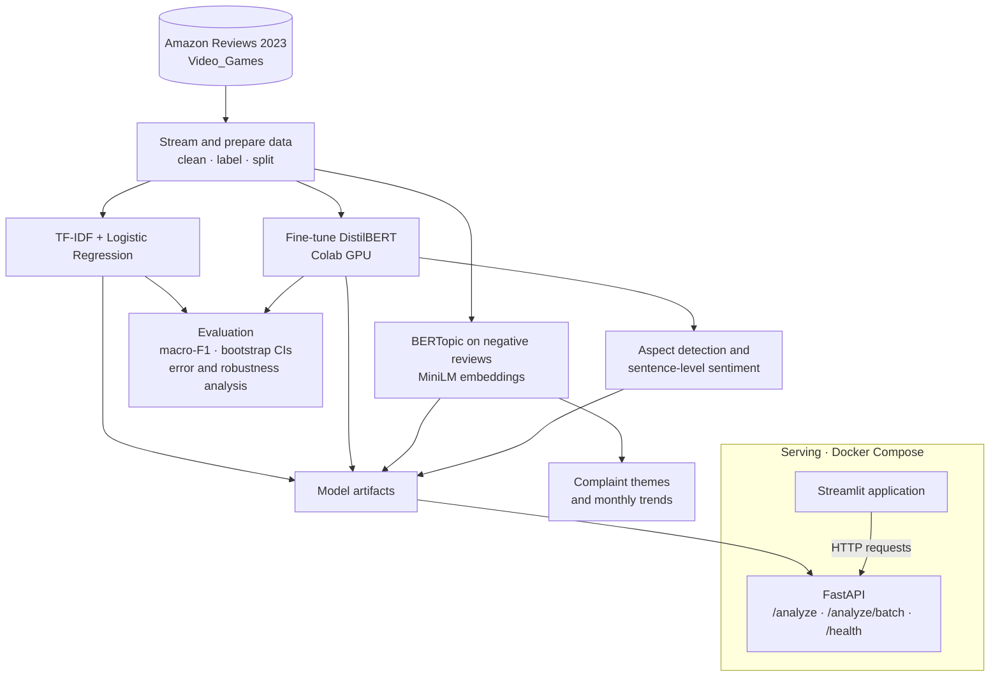

# ReviewLens

<p align="center">
  <strong>Turn customer reviews into product decisions.</strong><br/>
  Sentiment classification, complaint discovery, aspect-level analysis, explainability, and review trends in one deployable pipeline.
</p>

<p align="center">
  
  
  
  
  
  
  
  
</p>

ReviewLens is an end-to-end review-intelligence project built on the **Amazon Reviews 2023 — Video Games** category. It compares a TF-IDF + logistic-regression baseline with fine-tuned DistilBERT for three-class sentiment, discovers complaint themes in negative reviews with BERTopic, estimates sentiment for individual product aspects, tracks changes over time, and explains model predictions. A FastAPI service exposes the analysis, while a Streamlit application provides an interface; both can be run with Docker Compose.

## What it answers

| Question | What ReviewLens provides |
|---|---|
| Is sentiment changing over time? | The negative share rose from **14.0% in 2014** to **24.2% in 2022** in this dataset. |
| What are customers complaining about? | Nine discovered themes, led by controller/accessory defects and headset failures. |
| Which product aspects attract negative feedback? | Aspect-level analysis across 13 aspects; support and returns is the only net-negative aspect in the reported test-split summary. |
| Can an individual review be analysed? | Yes. The API and app return sentiment and supporting analysis, including explanations. |

> **Reproducibility:** Reported values are generated into files under `reports/`; `tests/test_readme_numbers.py` checks the main README figures against those files. See [DECISIONS.md](docs/DECISIONS.md) for design rationale and [RESULTS.md](docs/RESULTS.md) for fuller results and caveats.

## Highlights

- **Model comparison:** TF-IDF + logistic regression baseline versus fine-tuned DistilBERT.
- **Evaluation discipline:** chronological time hold-out, macro-F1 as the primary metric, paired bootstrap confidence intervals, error analysis, and perturbation tests.
- **Complaint discovery:** BERTopic clustering over negative reviews, with representative theme summaries.
- **Aspect sentiment:** keyword and embedding-based aspect detection paired with sentence-level DistilBERT sentiment.
- **Explainability:** logistic-regression feature coefficients and DistilBERT Integrated Gradients attributions using Captum.
- **Trend analysis:** monthly sentiment and topic tracking with a simple rule to flag unusual theme-share increases.
- **Serving:** FastAPI endpoints, Streamlit interface, and Docker Compose deployment.

## Dataset and labels

- **Source:** [Amazon Reviews 2023](https://huggingface.co/datasets/McAuley-Lab/Amazon-Reviews-2023), category `Video_Games`, streamed from the Hugging Face Hub. The dataset card has no license field; the project therefore treats the data as research use only and does not redistribute it.
- **Sample:** a uniform random sample of 75,000 reviews from the source file, cleaned to 60,000 reviews dated 1999-11-05 through 2023-09-05. Cleaning removes HTML, empty and duplicate reviews, and non-English text.
- **Labels:** 1–2 stars = negative, 3 stars = neutral, 4–5 stars = positive.
- **Class distribution:** 72.8% positive, 19.5% negative, 7.7% neutral.
- **Splits:** the latest 10% by date (6,000 reviews from 2022-04-24 onward) is held out for temporal evaluation. The remaining 54,000 reviews are split with 80/10/10 stratification and seed 42: 43,200 train, 5,400 validation, and 5,400 test.
- **Leakage controls:** model and hyperparameter choices use validation data; each final model is evaluated on the test set once; vectorizers are fit on training data only.

## Results

### Sentiment classification

Macro-F1 is the primary metric because accuracy can overstate performance when positive reviews dominate. Confidence intervals are paired bootstrap percentile intervals over 1,000 resamples.

| Evaluation split | TF-IDF + logistic regression | DistilBERT | Difference |
|---|---:|---:|---:|
| Test (5,400 reviews) | 0.6584 (0.6436–0.6742) | **0.6949 (0.6797–0.7108)** | +0.0365 (0.0208–0.0520) |
| Time hold-out (6,000 reviews) | 0.6603 (0.6469–0.6751) | **0.7023 (0.6882–0.7167)** | +0.0419 (0.0275–0.0575) |

Test accuracy is 0.8130 for the baseline and 0.8444 for DistilBERT.

**Per-class test F1**

| Class | TF-IDF + logistic regression | DistilBERT |
|---|---:|---:|
| Negative | 0.7464 | **0.7935** |
| Neutral | 0.3277 | **0.3628** |
| Positive | 0.9011 | **0.9284** |

DistilBERT has higher macro-F1 on both splits, and both paired-difference intervals exclude zero. The neutral class remains the weakest class for both models. Each model was trained once, so the reported intervals do not capture seed-to-seed training variation. DistilBERT used default hyperparameters (3 epochs, learning rate 2e-5) without a search; the baseline used a small validation grid.

### Error analysis

DistilBERT misclassifies 840 of the 5,400 test reviews. A random sample of 60 errors was manually tagged:

| Failure type | Count |
|---|---:|
| Mixed sentiment (pros and cons in one review) | 31 |
| Other (very short, descriptive, no usable opinion) | 15 |
| Neutral boundary (mild 3-star text) | 10 |
| Label noise (text contradicts the rating) | 4 |
| Sarcasm | 0 |

Most errors involve the neutral class (706 of 840). The model often predicts neutral for reviews that contain both positive and negative points, even when the star rating reflects the reviewer's final verdict. The tags were assigned by one annotator and were not independently checked. See [ERROR_ANALYSIS.md](docs/ERROR_ANALYSIS.md).

### Robustness checks

Change in test macro-F1 after perturbing review text (labels held unchanged):

| Perturbation | TF-IDF + logistic regression | DistilBERT |
|---|---:|---:|
| Typos (15% of words) | -0.0144 | -0.0144 |
| Upper/lower case | 0.0000 | 0.0000 |
| Neutral emoji appended | 0.0000 | +0.0032 |
| Truncated to first 8 tokens | -0.1094 | -0.1329 |
| “not” inserted before a polar word | -0.0788 | -0.2355 |

Case and emoji results are zero by construction: both models lowercase input and the baseline drops emoji. They should not be interpreted as evidence of robustness. Inserting “not” changes the meaning without updating the label, so that experiment measures sensitivity rather than whether predictions remain correct.

### Complaint themes

BERTopic is fit on negative training reviews using `all-MiniLM-L6-v2` embeddings. Mean c_v coherence is 0.534. Theme names are concise descriptions written from top words and representative reviews.

| Discovered theme | Negative reviews |
|---|---:|
| Controller and accessory defects | 2,049 |
| Headset audio and mic failure | 1,427 |
| Game will not install or run | 1,152 |
| Boring or poor games | 1,149 |
| Mouse and keyboard keys failing | 1,021 |
| Broke after short use | 745 |
| Switch and 3DS cases and screen protectors | 334 |
| Short verdicts: cheap, waste of money | 196 |
| Packaging and condition on arrival | 81 |

The clustering left 3,517 of 11,671 negative reviews (30.1%) unassigned. The API and trend view assign every negative review to its nearest theme; weak matches should therefore be interpreted cautiously.

### Aspect sentiment

The pipeline analyses 13 aspects: gameplay, graphics, story, sound, controls, durability, price_value, battery, comfort_fit, delivery_packaging, support_returns, compatibility_setup, and performance_bugs. Aspects are mapped using keywords plus embedding similarity; DistilBERT scores sentiment at sentence level.

Evaluation was performed once on 100 hand-labelled test sentences (82 aspect-sentiment pairs).

| Measure | Result |
|---|---:|
| Aspect detection precision / recall / F1 | 0.830 / 0.537 / 0.652 |
| Sentiment accuracy when an aspect was found | 0.682 (95% CI 0.534–0.800, 44 pairs) |
| End-to-end accuracy (missed aspect counts as wrong) | 0.366 (95% CI 0.270–0.474, 82 pairs) |

Aspect detection misses aspects that are expressed without lexicon terms (38 of 82 pairs); ambiguous words can create false aspects (9), and a sentence with two opinions receives one sentiment score for both. The evaluation labels and lexicon share an author, which may make the reported figures optimistic. In the test split, support and returns is the only net-negative aspect: 49.4% of reviews mentioning it are negative and 35.1% are positive.

### Trends and explainability

- The negative share rose from 14.0% in 2014 to 24.2% in 2022. Over the same period, negative reviews shifted from game complaints toward hardware complaints. The dataset cannot establish whether this reflects product-quality changes or a changing mix of reviewed products.
- The theme-spike heuristic flagged 13 months across 12 episodes. Most were single-month spikes, and flags were not stable across two topic-assignment methods. Treat them as leads for investigation, not confirmed findings.
- For logistic regression, class-level feature coefficients are saved in `reports/lr_top_ngrams.json`.
- For DistilBERT, Captum Integrated Gradients produces token attributions. In 84.2% of 95 reviews, deleting the three most attributed words lowered the predicted-class probability more than deleting three random words. Attributions are noisy on long reviews; a gallery is available at `reports/figures/explanations.html`.

### Serving performance

Measured over HTTP in the Docker container on the author's CPU, using 50 test reviews:

| Request type | Median latency | 95th percentile |
|---|---:|---:|
| Sentiment only | 120 ms | 247 ms |
| Full analysis with explanations | 619 ms | 2,167 ms |

The same code run directly on Windows was about twice as slow. These are machine-specific measurements, not a production latency guarantee.

## Architecture

The workflow separates data preparation, model development, evaluation, analysis, and inference. The trained baseline, transformer, topic model, and aspect pipeline feed the FastAPI service; the Streamlit app calls the service rather than duplicating inference logic.



**Repository layout**

- `src/reviewlens/`: reusable pipeline code for data, models, evaluation, topics, aspects, explainability, and API.
- `configs/`: YAML configuration.
- `scripts/`: runnable pipeline steps.
- `app/`: Streamlit application.
- `notebooks/`: Colab training and visualization notebooks.
- `reports/`: generated metrics, tables, and figures (created by the pipeline).

## Getting started

### Requirements

Python 3.11, [uv](https://docs.astral.sh/uv/), `make`, and Docker for containerized serving. The dataset and trained model weights are not stored in the repository.

### Install and prepare data

```bash
make setup          # Create environment and install dependencies
make data           # Stream, clean, and split data (~10 minutes; ~2.7 GB read)
make baseline       # Train/select TF-IDF + LR using validation data
```

### Train DistilBERT

DistilBERT training requires a GPU. A free Colab T4 takes approximately eight minutes in the documented setup:

1. Push the repository to GitHub.
2. Open `notebooks/02_train_distilbert_colab.ipynb` in Google Colab.
3. Upload `data/processed/*.parquet`.
4. Run all cells and download the generated archive.
5. Extract the archive into the repository root. It creates `models/distilbert/` and the Phase 3 files in `reports/`.

Then run the remaining analysis steps:

```bash
make eval           # Bootstrap CIs, drift, error sample, robustness
make topics         # BERTopic on negative reviews and monthly trends
make aspects        # Aspect evaluation and test-split summary
make explain        # LR n-grams, attribution gallery, deletion check
make test           # pytest
make lint           # Ruff
```

**CPU note:** DistilBERT inference for the perturbed test set is slow on CPU. Run `notebooks/02b_robustness_colab.ipynb` in Colab to generate `reports/robustness_distilbert.json`, then run `make eval` to finish the figures. The manually tagged errors in `reports/error_tags.csv` are committed.

### Run the API and dashboard

Run locally in separate terminals:

```bash
make api            # FastAPI at http://localhost:8000; docs at /docs
make app            # Streamlit at http://localhost:8501
```

Or start both containers:

```bash
docker compose up --build
```

Docker Compose exposes the API on port 8000 and the Streamlit app on port 8501. The app calls the API using `API_URL`; the Compose configuration sets this to `http://api:8000`. The API container mounts `./models` read-only.

### Example API request

```bash
curl -X POST http://localhost:8000/analyze \
  -H 'content-type: application/json' \
  -d '{"text": "The controller stick broke after two weeks. Waste of money."}'
```

The service also provides `/analyze/batch` and `/health`.

## CI

GitHub Actions runs on pushes to `main` and pull requests. The workflow installs Python 3.11 dependencies, runs `ruff check .`, and executes `pytest -q`. Tests that require trained model artifacts skip when `models/` is absent.

## Limitations

- **Single category and dataset:** results are specific to Amazon Video Games reviews and may not generalize to other products or platforms.
- **One training run per model:** seed-to-seed variation is not measured, and DistilBERT was not hyperparameter-tuned.
- **Noisy star-rating labels:** the neutral 3-star class is only 7.7% of the sample and has the weakest F1 for both models.
- **Single-annotator evaluation:** error tags, topic labels, and aspect evaluation labels were not independently verified; the aspect lexicon and labels share an author.
- **Limited aspect recall:** aspect detection recall is 0.537, and assigning one sentiment per sentence can misrepresent mixed opinions.
- **Forced theme assignment in serving:** around 30% of negative reviews were unassigned during clustering, while API and trend views assign each negative review to its nearest theme. Similarity should be inspected for weak matches.
- **Trend interpretation:** a change in review sentiment is not necessarily a change in product quality; the product mix changes over time.
- **Input truncation:** DistilBERT truncates long reviews to 128 word pieces; the API indicates when this occurs.
- **Machine-dependent latency:** full-analysis p95 latency was slightly above two seconds in the measured Docker environment.
- **No visual browser review:** Streamlit pages have been tested with the Streamlit test harness, but their layout has not been reviewed visually and screenshots are not included.

## Future work

- Train across several seeds and run a small DistilBERT hyperparameter search.
- Treat sentiment as ordinal or regress star ratings to better handle the neutral class.
- Split sentences at contrast terms (such as “but” and “however”), expand the aspect lexicon, and evaluate on a fresh dataset annotated by a second person.
- Add a second annotator for error tags and topic labels, reporting inter-annotator agreement.
- Calibrate probabilities and evaluate additional product categories.

## License

This project is licensed under the MIT License. See [LICENSE](LICENSE) for details.

---

[Design decisions](docs/DECISIONS.md) · [Detailed results](docs/RESULTS.md) · [Error analysis](docs/ERROR_ANALYSIS.md)
