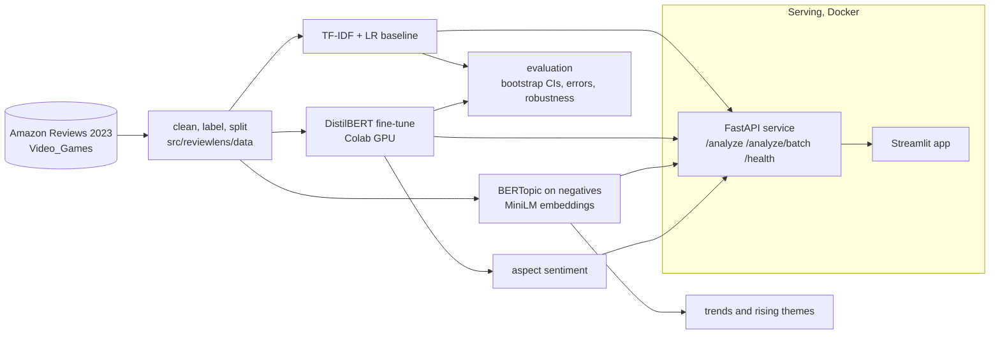

# ReviewLens

Turn raw customer reviews into decisions: sentiment, complaint themes, aspect-level insight and trends in one tool.

ReviewLens is a review-intelligence pipeline built on Amazon product reviews (Video Games category). It compares a TF-IDF + logistic regression baseline with a fine-tuned DistilBERT for 3-class sentiment, finds complaint themes in negative reviews with BERTopic, scores sentiment per aspect (price, durability, support and others), tracks sentiment and themes over time, explains predictions, and serves everything through a FastAPI service and a Streamlit app (Docker included).

It answers four questions:

1. Is overall sentiment improving or declining? It has declined: the negative share of reviews rose from 14.0% in 2014 to 24.2% in 2022 (see [Trends](#trends)).
2. What are the top complaint themes? Nine themes; hardware failures (controllers, headsets, keyboards and mice) are the largest groups (see [Complaint themes](#complaint-themes)).
3. Which aspects drive negative sentiment? Customer support and returns is the only net-negative aspect; in negative reviews durability and price are mentioned most (see [Aspects](#aspect-sentiment)).
4. Can a new review be classified and explained instantly? Yes, through the API and app (see [Serving](#serving)).

Every number below comes from a file in `reports/` produced by the code; `tests/test_readme_numbers.py` checks the main ones against those files. Rationale for each design choice is in [`docs/DECISIONS.md`](docs/DECISIONS.md), and the full results with caveats are in [`docs/RESULTS.md`](docs/RESULTS.md).

## Dataset and labels

- **Data:** [Amazon Reviews 2023](https://huggingface.co/datasets/McAuley-Lab/Amazon-Reviews-2023), category `Video_Games`, streamed from the Hugging Face Hub. The dataset card has no license field, so the data is treated as research use only and is not redistributed here.
- **Sample:** a uniform random sample of 75,000 reviews from the whole file, cleaned (HTML stripped, empty, duplicate and non-English reviews removed) to 60,000 reviews dated 1999-11-05 to 2023-09-05.
- **Labels:** 1-2 stars = negative, 3 stars = neutral, 4-5 stars = positive. The classes are imbalanced: 72.8% positive, 19.5% negative, 7.7% neutral.
- **Splits:** the latest 10% by date (from 2022-04-24, 6,000 reviews) is kept out as a time hold-out; the rest is split 80/10/10 with stratification and seed 42: 43,200 train, 5,400 validation, 5,400 test.
- **Discipline:** hyperparameters and model choices use validation data only; each final model touches the test set once; vectorizers are fit on train only.

## Results

### Sentiment: baseline vs DistilBERT

Primary metric is macro-F1 (accuracy overstates quality because most reviews are positive). 95% intervals are paired bootstrap percentile intervals over 1,000 resamples.

| Split | TF-IDF + LR | DistilBERT | Difference |
|---|---|---|---|
| Test (5,400) | 0.6584 (0.6436 to 0.6742) | 0.6949 (0.6797 to 0.7108) | +0.0365 (0.0208 to 0.0520) |
| Time hold-out (6,000) | 0.6603 (0.6469 to 0.6751) | 0.7023 (0.6882 to 0.7167) | +0.0419 (0.0275 to 0.0575) |

Test accuracy is 0.8130 for the baseline and 0.8444 for DistilBERT. Per-class F1 on the test split:

| Class | TF-IDF + LR | DistilBERT |
|---|---|---|
| negative | 0.7464 | 0.7935 |
| neutral | 0.3277 | 0.3628 |
| positive | 0.9011 | 0.9284 |

- DistilBERT is better, and the difference interval excludes zero on both splits. The gain is mostly on negative and positive reviews; neutral (3-star) stays the weak class for both models.
- There is no sign of drift: neither model scores lower on the newer time hold-out, although its negative share is higher (23.8% against 19.0% on the test split).
- Each model was trained once, so the intervals do not include seed-to-seed variation. DistilBERT used one set of default hyperparameters (3 epochs, learning rate 2e-5) with no search; the baseline got a small validation grid.

### Error analysis

DistilBERT misclassifies 840 of the 5,400 test reviews. A random sample of 60 was tagged by reading each one ([`docs/ERROR_ANALYSIS.md`](docs/ERROR_ANALYSIS.md)):

| Failure type | Count of 60 |
|---|---|
| mixed sentiment (pros and cons in one review) | 31 |
| other (very short, descriptive, no usable opinion) | 15 |
| neutral boundary (mild 3-star text) | 10 |
| label noise (text contradicts the rating) | 4 |
| sarcasm | 0 |

Most errors involve the neutral class (706 of the 840): the model predicts "neutral" for reviews that state both good and bad points while the star rating follows the reviewer's final verdict. The tags come from a single annotator and were not independently checked.

### Robustness

Change in test macro-F1 after perturbing the review text (true labels unchanged), with 95% bootstrap intervals in the JSON files:

| Perturbation | TF-IDF + LR | DistilBERT |
|---|---|---|
| Typos (15% of words) | -0.0144 | -0.0144 |
| Upper or lower case | 0.0000 | 0.0000 |
| Neutral emoji appended | 0.0000 | +0.0032 |
| Truncated to the first 8 tokens | -0.1094 | -0.1329 |
| "not" inserted before a polar word | -0.0788 | -0.2355 |

Case and emoji effects are zero by construction (both models lowercase their input, and the baseline drops emoji), so they are not evidence of robustness. Negation insertion does not preserve the label, so it measures sensitivity, not accuracy: DistilBERT reacts much more than the baseline, which this test cannot judge as good or bad.

### Complaint themes

BERTopic on negative reviews (`all-MiniLM-L6-v2` embeddings, fit on the 8,193 train negatives, mean c_v coherence 0.534). The labels are short descriptions written from the top words and representative reviews:

| Theme | Negative reviews |
|---|---|
| Controller and accessory defects | 2,049 |
| Headset audio and mic failure | 1,427 |
| Game will not install or run | 1,152 |
| Boring or poor games | 1,149 |
| Mouse and keyboard keys failing | 1,021 |
| Broke after short use | 745 |
| Switch and 3DS cases and screen protectors | 334 |
| Short verdicts: cheap, waste of money | 196 |
| Packaging and condition on arrival | 81 |

3,517 of the 11,671 negative reviews (30.1%) were left unassigned by the clustering. The API and the trend view instead assign every negative review to its nearest theme.

### Aspect sentiment

Thirteen aspects (gameplay, graphics, story, sound, controls, durability, price_value, battery, comfort_fit, delivery_packaging, support_returns, compatibility_setup, performance_bugs), mapped by keywords plus embedding similarity and scored by DistilBERT at sentence level. Evaluated once on 100 hand-labeled test sentences (82 aspect-sentiment pairs):

| Measure | Value |
|---|---|
| Aspect detection precision / recall / F1 | 0.830 / 0.537 / 0.652 |
| Sentiment accuracy when the aspect was found | 0.682 (95% CI 0.534 to 0.800, 44 pairs) |
| End to end (a missed aspect counts as wrong) | 0.366 (95% CI 0.270 to 0.474, 82 pairs) |

Failure modes: aspects stated without a lexicon word are missed (38 of 82 pairs), single words in the wrong sense add false aspects (9), and a sentence with two opinions gets one sentiment for both aspects. The labels come from the same annotator who wrote the lexicon, so the figures are probably optimistic. On the test split, support and returns is the only net-negative aspect (49.4% of reviews mentioning it are negative, 35.1% positive).

### Trends

- The negative share of reviews rose from 14.0% (2014) to 24.2% (2022). Over the same years, negative reviews moved from game complaints to hardware complaints, which likely explains much of the rise; the data cannot separate that from a real drop in quality.
- A simple rule flags months where a theme's share is at least 3 binomial z-scores and 5 points above the previous six months. It found 13 flagged months in 12 episodes, almost all single-month spikes rather than sustained rises, and the flags were not stable across two ways of assigning topics. Treat them as leads, not findings.

### Explainability

- **Logistic regression:** the largest coefficients per class are in `reports/lr_top_ngrams.json` (for example "terrible", "waste" and "worst" for negative; "great", "love" and "perfect" for positive; hedging words such as "but" and "however" for neutral).
- **DistilBERT:** Integrated Gradients (Captum) token attributions, with a static gallery of 10 test reviews in `reports/figures/explanations.html`. Deleting the 3 most attributed words lowers the predicted class's probability more than deleting 3 random words in 84.2% of 95 reviews, so the attributions track the model; they are noisy on long reviews.

### Serving

Latency over HTTP in the Docker container on this machine's CPU (50 test reviews): sentiment-only calls take a median of 120 ms (95th percentile 247 ms); the full analysis with explanations takes a median of 619 ms and a 95th percentile of 2,167 ms. The same code run directly on Windows was about twice as slow.

## Architecture



Logic lives in `src/reviewlens/` (`data`, `models`, `eval`, `topics`, `aspects`, `explain`, `api`), configuration in `configs/*.yaml`, runnable steps in `scripts/`, the app in `app/`, and the thin Colab and visualization notebooks in `notebooks/`.

## How to run

Requirements: Python 3.11, [`uv`](https://docs.astral.sh/uv/), `make`, and Docker for the containers. Data and model weights are not in the repository.

```bash
make setup          # venv and all dependencies
make data           # stream, clean and split the data (about 10 minutes, ~2.7 GB read)
make baseline       # TF-IDF + LR: select on validation, score test once
```

DistilBERT training needs a GPU (a free Colab T4 takes about 8 minutes). Push the repo, open `notebooks/02_train_distilbert_colab.ipynb` in Colab, upload `data/processed/*.parquet`, run all cells, and unzip the downloaded archive in the repo root (it creates `models/distilbert/` and the Phase 3 files in `reports/`). Then:

```bash
make eval           # bootstrap CIs, drift, error sample, robustness (see note)
make topics         # BERTopic on negatives, then monthly trends
make aspects        # hand-labeled aspect evaluation and test-split summary
make explain        # LR n-grams, attribution gallery, deletion check
make test           # pytest
make lint           # ruff
```

Note on `make eval`: DistilBERT inference on the perturbed test set is slow on CPU. Run `notebooks/02b_robustness_colab.ipynb` in Colab to produce `reports/robustness_distilbert.json`, then `make eval` finishes with the figures. The error tags in `reports/error_tags.csv` are hand-written and are committed.

Run the service and app:

```bash
make api            # FastAPI on http://localhost:8000 (docs at /docs)
make app            # Streamlit on http://localhost:8501, calls the API (API_URL overrides the address)
docker compose up --build   # both, with ./models mounted read-only into the API container
```

Example call:

```bash
curl -X POST localhost:8000/analyze -H 'content-type: application/json' \
  -d '{"text": "The controller stick broke after two weeks. Waste of money."}'
```

CI (`.github/workflows/ci.yml`) runs `ruff` and `pytest` on every push. Tests that need trained models skip themselves when `models/` is absent.

## Limitations

- **One category, one dataset, one run per model.** No seed variation is measured, and DistilBERT had no hyperparameter search.
- **Star ratings are noisy labels,** especially the 3-star neutral class (7.7% of the data), where both models are weak (F1 0.33 and 0.36).
- **Single-annotator hand work.** Error tags, topic labels and the aspect evaluation labels were each written by one annotator and not independently verified; the aspect labels and the lexicon share an author.
- **Aspect detection misses almost half of the aspects** (recall 0.54) and assigns one sentiment per sentence, so mixed sentences are mislabeled.
- **Topics are always assigned,** even to reviews the nine themes do not describe; the API returns the similarity so weak matches are visible. About 30% of negative reviews did not fit a cluster when the model was fit.
- **The sentiment trend is not a quality trend:** the mix of products reviewed changed over the years.
- **Long reviews are truncated** to 128 word pieces by the model (the API says when).
- **Latency:** the 95th percentile of the full analysis in Docker is slightly above 2 seconds on this machine; results depend on the CPU Docker is given.
- **Not checked in a browser:** the Streamlit pages are tested with Streamlit's test harness but the layout has not been reviewed visually, and no screenshots are included.

## Future work

- Several seeds and a small hyperparameter search for DistilBERT; report the spread.
- Treat sentiment as ordinal (or regress the rating) to handle the neutral class better.
- Split sentences at contrasts ("but", "however") and extend the aspect lexicon, then re-evaluate on a fresh labeled set annotated by a second person.
- A second annotator for the error tags and topic labels, with agreement reported.
- Calibrate the probabilities (validation loss rose while macro-F1 kept improving), and evaluate other product categories.
